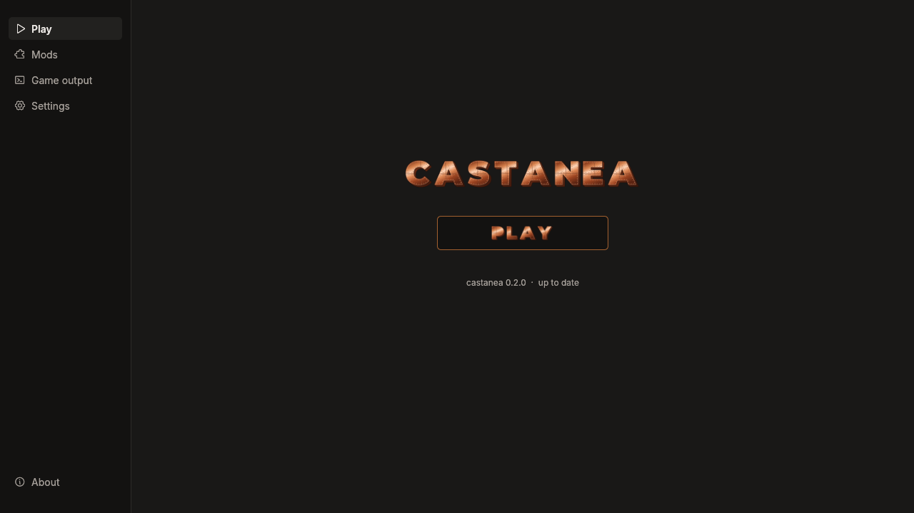
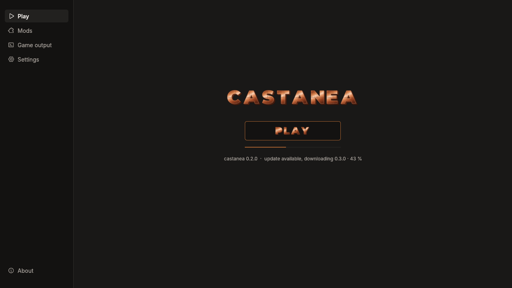
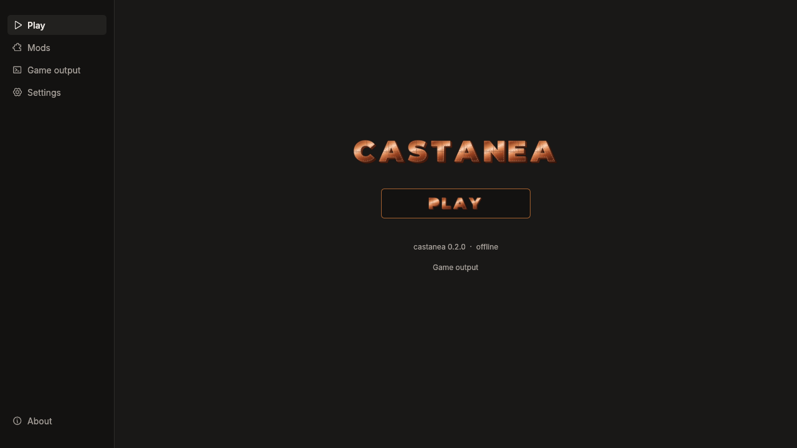
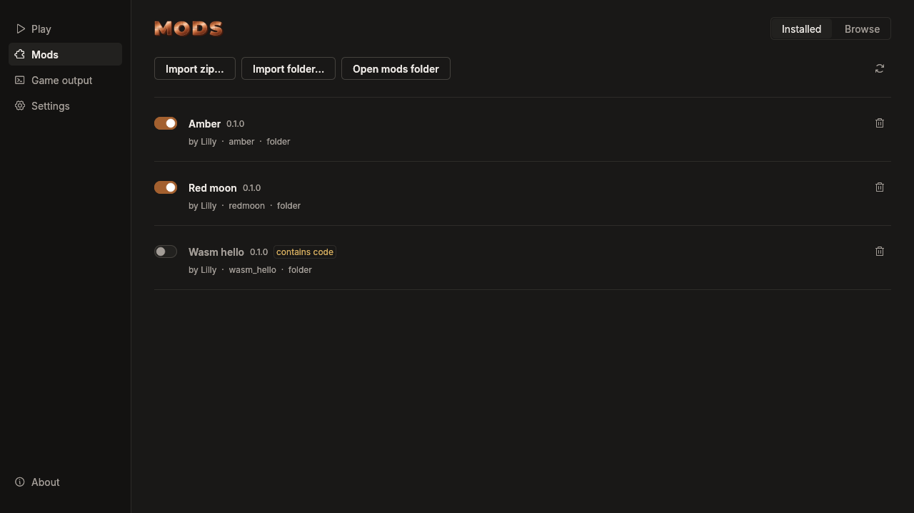
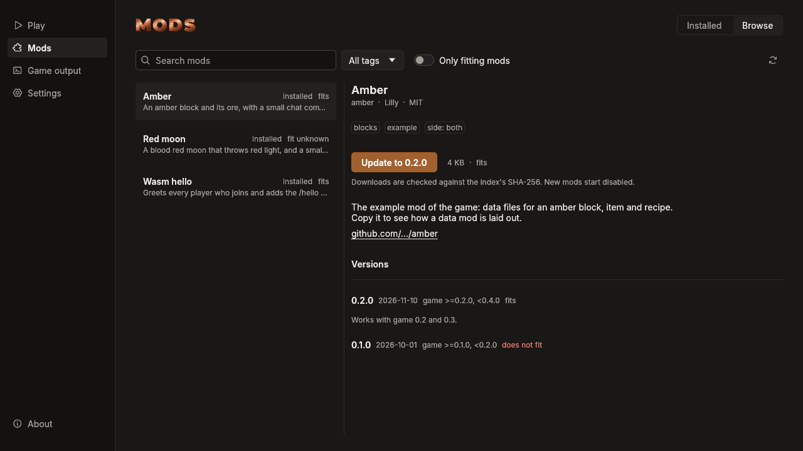
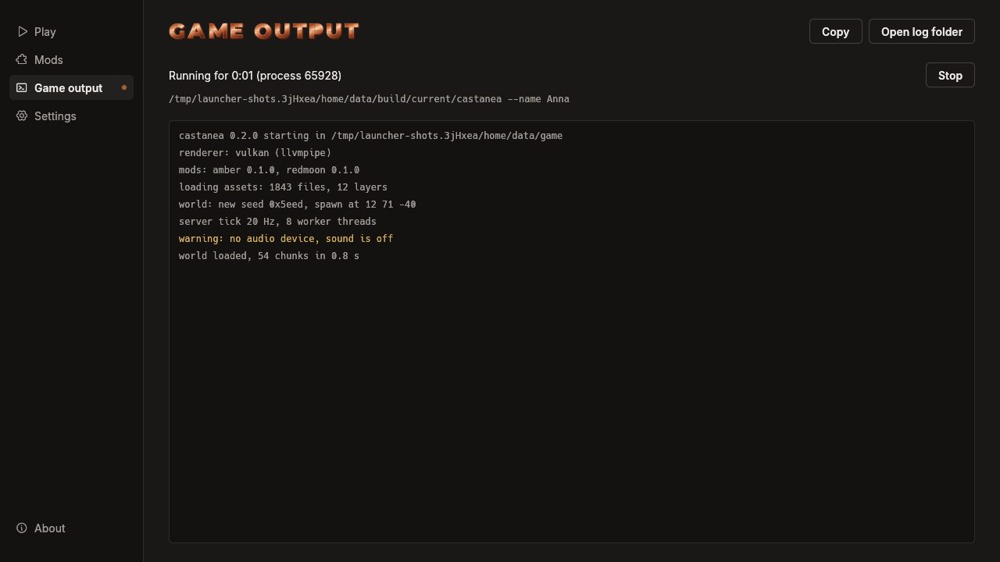
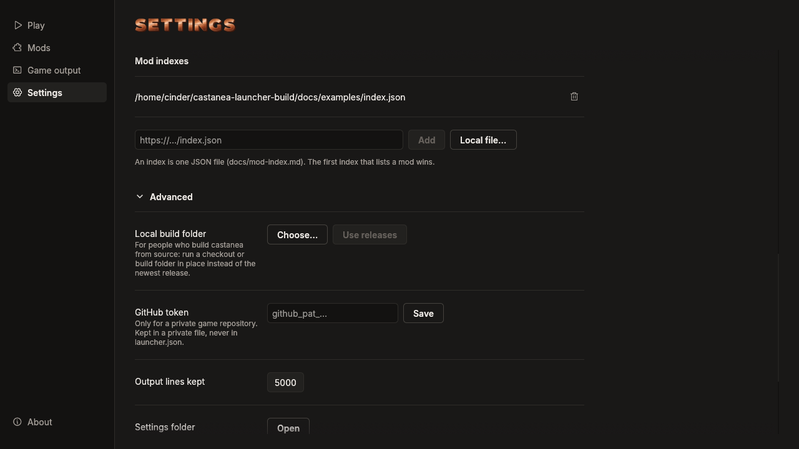

# castanea launcher

A native launcher for [castanea](https://github.com/TerraNuxt/castanea): one Play button. It keeps the game at its
newest release (checked, downloaded and verified at start), starts it, and is a mod manager and mod browser. Rust with
[egui](https://github.com/emilk/egui), no web view. Windows and Linux.



| | |
|---|---|
|  |  |
|  |  |
|  |  |
|  |  |
|  |  |

## What it does

- **Play**: the name, one Play button (F5) and one status line: the installed version and whether it is up to date,
  an update downloading with its percentage, or offline. While the game runs the button is Stop with the running time.
  There are no profiles and no version choice: one game install, one game folder, always the newest release.
- **Updates**: at start the launcher asks the GitHub releases of `TerraNuxt/castanea` for the newest build, downloads
  it, checks its SHA-256 and swaps it in; a download that fails the check is thrown away and the installed build stays.
  Offline, the installed build is used.
- **Mods → Installed**: the mods of the game folder from `mod.json`: switch on and off, remove, update, import a zip
  or folder, open the folder; missing or disabled dependencies, duplicate ids, cycles and game-version mismatches are
  shown.
- **Mods → Browse**: search and filter an index ([format](docs/mod-index.md)), details, install with progress and hash
  check, updates. Works offline from the cache.
- **Game output**: the live output, also in `logs/latest.log` of the game folder; a crash (exit code or a new report
  in `crash/`) is shown with its report.
- **Settings**: language, offline mode; the game's player name, relay server (`backend_url`), graphics backend
  (`CASTANEA_BACKEND=vulkan|wgpu`), window size, extra arguments and environment; mod indexes; under Advanced a local
  build folder for people who build the game from source, a GitHub token for a private game repo, and the folders.
- English and German (`crates/ui/lang/*.json`), a matte dark theme, keyboard shortcuts (Ctrl+1…5, F5, Ctrl+F, Tab,
  Enter, Esc), screen reader names for every control (AccessKit), the system window frame, window size and position
  remembered, from 1000x640 up.

An older launcher home with profiles is moved over once: the last used profile's options and game folder are kept,
the other profile folders stay where they are.

Design, the update flow and the security model: [docs/design.md](docs/design.md). The look, every page as a wireframe
and the theme tokens: [docs/ui-design.md](docs/ui-design.md). Packaging: [docs/packaging.md](docs/packaging.md), Nix
flake: [docs/nix.md](docs/nix.md). Testing on Windows: [docs/windows.md](docs/windows.md).

## Build

```sh
cargo run --release -p castanea-launcher
cargo test --workspace
```

Rust 1.92 or newer. On Linux the window needs the usual runtime libraries (Vulkan or GL driver, X11 or Wayland,
xkbcommon); `tools/shell.nix` has them for NixOS. On Windows, the MSVC toolchain.

`CASTANEA_LAUNCHER_HOME=<dir>` keeps everything below one folder (portable mode). `--game-dir <dir>` or
`CASTANEA_GAME_DIR=<dir>` runs a local build folder (a checkout with `target/release/castanea`) instead of the newest
release, for one run. `CASTANEA_GITHUB_TOKEN` gives the token for a private game repo.

## Layout

| Path | What |
|---|---|
| `crates/core` | Everything without UI: folders, settings, the build and its updates, migration, launch, mods, index, downloads |
| `crates/ui` | The window (eframe): `app.rs` state, `game.rs` updates and the running game, `shell.rs` layout, `sidebar.rs`, `pages/` one file per page, `widgets/` components, `theme.rs` tokens, `lang/` strings, `assets/fonts` |
| `docs/` | Design, UI design, mod index format, packaging, Nix, Windows notes, screenshots, an example index |
| `third_party/` | Licences and sources of the foreign fonts (Inter, Phosphor); the own brand font has its note beside it |
| `tools/remote.sh` | Runs a command on the build host (`tools/remote.sh cargo test --workspace`) |
| `tools/winck.sh` | Windows cross-check (cargo check and clippy for a Windows target in a container) |
| `tools/screenshots.sh` | Takes `docs/screenshots` under a private Xvfb display (`castanea-launcher --screenshots DIR`) |

## License

MIT, see [LICENSE](LICENSE). The fonts in `crates/ui/assets/fonts` are Inter (SIL OFL 1.1) and Phosphor icons (MIT),
see `third_party/`, and the project's own copper brand font (`assets/fonts/castanea`, no foreign licence) for the
wordmark, titles and the Play label.
