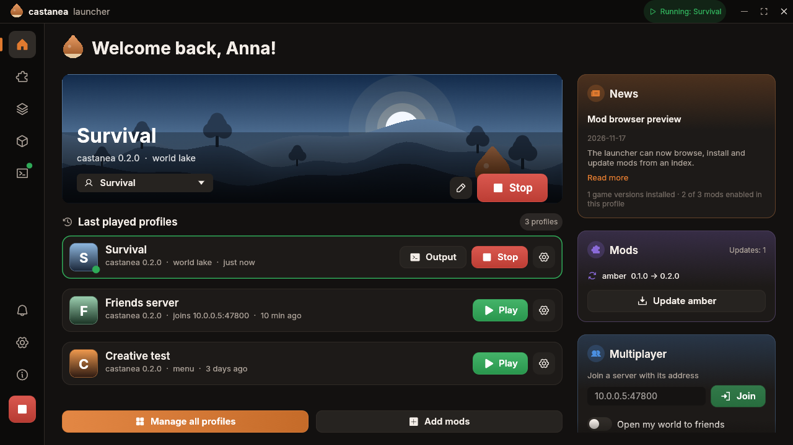
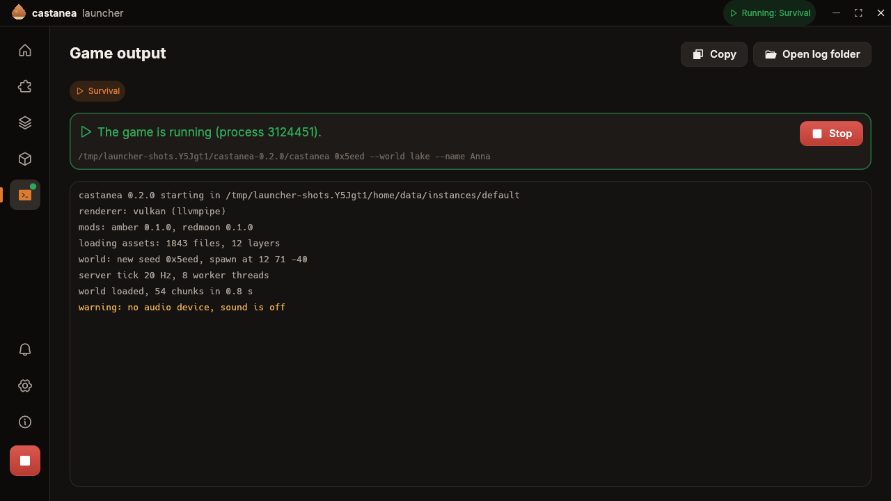
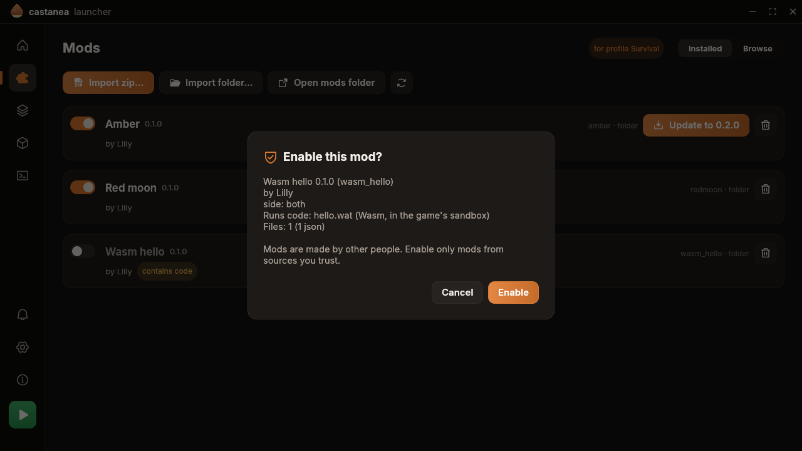
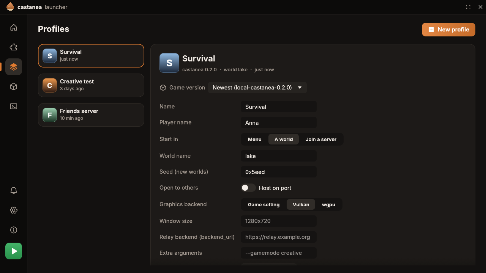
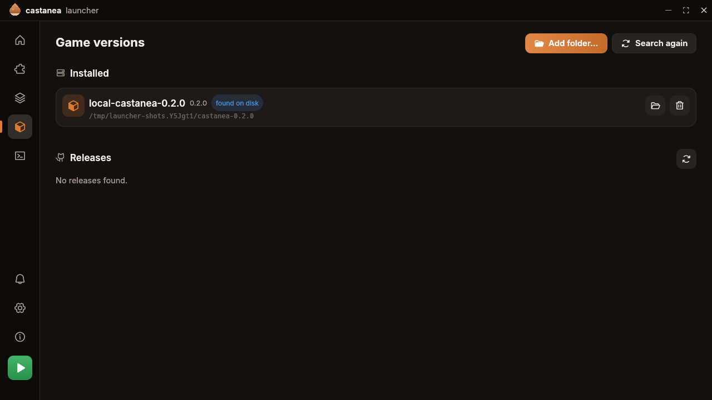
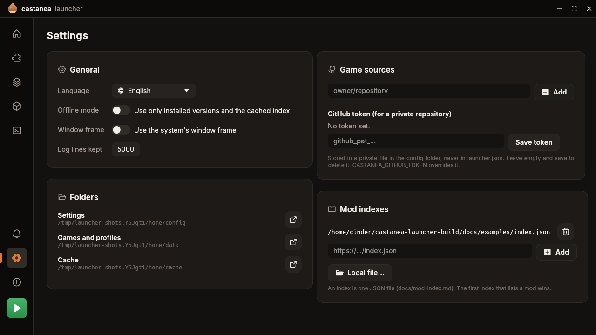
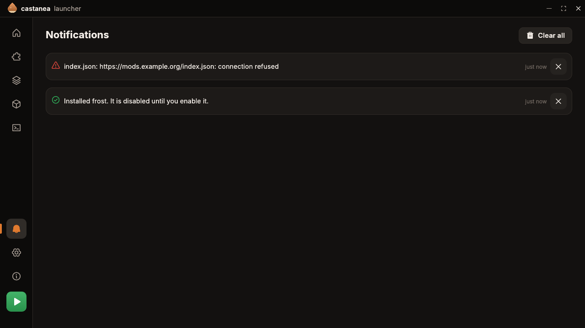
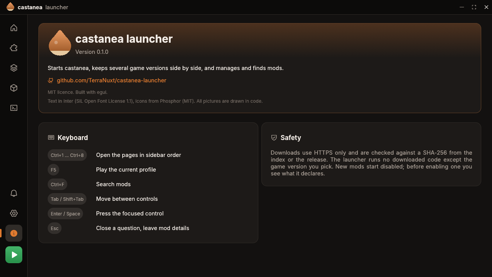
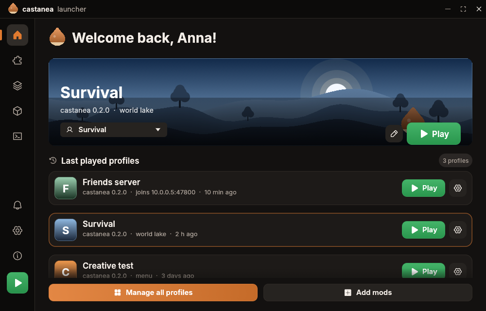

# castanea launcher

A native launcher for [castanea](https://github.com/TerraNuxt/castanea): it starts the game, keeps several game
versions side by side, and is a mod manager and mod browser. Rust with [egui](https://github.com/emilk/egui), no web
view. Windows and Linux.


| | |
|---|---|
|  |  |
|  |  |
|  |  |
|  |  |
|  |  |
|  |  |

## What it does

- **Home**: a welcome line, a banner with the current profile, a profile picker and Play (F5); the last played
  profiles as cards with Play and options (a running one gets a green outline, Output and Stop); news, mod updates,
  multiplayer (join an address, open your world) and shortcuts on the right. Different profiles can run side by side.
- **Game output**: the live output of each started profile, also in `logs/latest.log` of the profile folder; a crash
  (exit code or a new report in `crash/`) is shown with its report.
- **Profiles**: each has its own game folder (saves, settings, mods), and options: game version, start in the menu, a
  world (seed, host port) or join a server; player name; `backend_url`; graphics backend
  (`CASTANEA_BACKEND=vulkan|wgpu`); window size; extra arguments and environment variables.
- **Game versions**: builds found on disk, folders you add (a release folder or a checkout with `target/release`), and
  releases of `TerraNuxt/castanea` (or any GitHub repo) downloaded with a SHA-256 check. A private repo needs a token.
- **Mods → Installed**: the profile's mods from `mod.json`: switch on and off, remove, update, import a zip or folder,
  open the folder; missing or disabled dependencies, duplicate ids, cycles and game-version mismatches are shown.
- **Mods → Browse**: search and filter an index ([format](docs/mod-index.md)), details, install with progress and hash
  check, updates. Works offline from the cache.
- **Notifications**: what happened (installs, errors, a game that ended or crashed); new ones also show as toasts.
- English and German (`crates/ui/lang/*.json`), dark theme with a chestnut accent, keyboard shortcuts (Ctrl+1…8, F5,
  Ctrl+F, Tab, Enter, Esc), screen reader names for every control (AccessKit), own window frame or the system's,
  window size and position remembered, from 1000x640 up.

Design and security model: [docs/design.md](docs/design.md). The look, every page as a wireframe and the theme tokens:
[docs/ui-design.md](docs/ui-design.md). Packaging: [docs/packaging.md](docs/packaging.md), Nix flake:
[docs/nix.md](docs/nix.md). Testing on Windows: [docs/windows.md](docs/windows.md).

## Build

```sh
cargo run --release -p castanea-launcher
cargo test --workspace
```

Rust 1.92 or newer. On Linux the window needs the usual runtime libraries (Vulkan or GL driver, X11 or Wayland,
xkbcommon); `tools/shell.nix` has them for NixOS. On Windows, the MSVC toolchain.

`CASTANEA_LAUNCHER_HOME=<dir>` keeps everything below one folder (portable mode). `CASTANEA_GAME_DIR=<dir>` points the
launcher at a game folder. `CASTANEA_GITHUB_TOKEN` gives the token for a private game repo.

## Layout

| Path | What |
|---|---|
| `crates/core` | Everything without UI: folders, settings, builds and sources, profiles, launch, mods, index, downloads |
| `crates/ui` | The window (eframe): `app.rs` state and actions, `shell.rs` layout, `chrome.rs` title bar and sidebar, `pages/` one file per page, `widgets/` components, `theme.rs` tokens, `lang/` strings, `assets/fonts` |
| `docs/` | Design, UI design, mod index format, packaging, Windows notes, screenshots, an example index |
| `third_party/` | Licences and sources of the fonts (Inter, Phosphor) |
| `tools/remote.sh` | Runs a command on the build host (`tools/remote.sh cargo test --workspace`) |
| `tools/winck.sh` | Windows cross-check (cargo check and clippy for a Windows target in a container) |
| `tools/screenshots.sh` | Takes `docs/screenshots` under a private Xvfb display (`castanea-launcher --screenshots DIR`) |

## License

MIT, see [LICENSE](LICENSE). The fonts in `crates/ui/assets/fonts` are Inter (SIL OFL 1.1) and Phosphor icons (MIT),
see `third_party/`. All pictures (banner, logo mark, tiles) are drawn in code.
