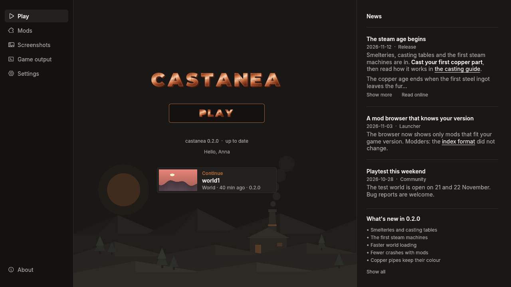

# Quick start: Continue

The home page shows a **Continue** card under Play when something was played before: the last world or server, a small
picture, when it was played and with which game version. One click starts the game straight in, without the start screen.
Play still opens the start screen. Code: `crates/core/src/history.rs` (the record and the detection, no UI),
`crates/ui/src/quick.rs` (state, the worker, recording), `crates/ui/src/pages/home/card.rs` (the card).

## What the game is asked

The game's command line is the contract ([game-launch.md](game-launch.md)):

| Continue goes to | Arguments |
|---|---|
| a world | `--world NAME` (`NAME`: the folder name in `saves/`) |
| a server | `--join HOST:PORT` or `--join CODE` |

plus `--name NAME` when there is a player name ([player-name.md](player-name.md)), then the extra arguments of Settings. The
launcher refuses a world name or an address that is not plain (no white space, none that starts with `-`), so what Continue
passes can never read as another option. Nothing else about the game changed: same folder, same graphics decision, same
"When the game starts" action.

## What counts as "last played"

Two sources, in this order:

1. **The launcher's own record of its starts**, `data/history.json` (the last 100 starts, oldest dropped): when the game was
   started, when the launcher saw it end, the game version and where it went (`menu`, `world` + name, `join` + address).
   It is written when the game has started, not before: a start that fails leaves no entry. Continue and a `--world` or `--join`
   in the extra arguments are remembered with their target. A start at the start screen is resolved afterwards: the world
   whose files changed while that game ran (the newest file below the world folder, three levels deep, links skipped) is the
   one that was played. If the game has run but changed no world, the next older start counts.
2. **The saves, read-only**, when the record has nothing usable (a fresh launcher home with an old game folder, an
   emptied record): the world folder (a folder with a `world.meta` and a plain name) with the newest file.

A world that no longer exists is skipped for the start before it. A server is shown by the name saved in the game's
`servers.txt` (`name<TAB>address`), else by its address. Nothing played, nothing found: no card, only Play.

The launcher never writes to the saves. A server joined from the game's own start screen leaves nothing the launcher can read, so
it is not remembered: only a join that the launcher started is.

The record is a convenience: a missing, empty or unreadable `history.json` (or one from a newer launcher with starts it does
not know) is an empty record, never an error. It lives in the Launcher settings row of Settings → Storage and reset, so
*Delete* there clears it.

## The card

- The picture: the newest screenshot taken during that play session (the gallery's folder, from the start to the end of the
  session, a few seconds of slack), else the world's own `preview.png`, else a placeholder. It is a thumbnail decoded on the
  gallery's worker threads and cached like the gallery's; the card never waits for it.
- Text: `Continue`, the world or server name, and `World · 2 h ago · 0.2.0` (`just now`, `n min ago`, `n h ago`, `n d ago`, from a
  month on the date). German: `Weiterspielen`, `Welt · vor 2 Std. · 0.2.0`.
- Not shown while the game runs (the button is Stop then) and shown again, with the new world, after it ended. It is a button
  for screen readers (`Continue: world1, World · 40 min ago · 0.2.0`) and for the keyboard (Tab, Enter). It is off while a build is
  being swapped, like Play.
- At the smallest window (880 x 500) the news below the Play block shrink to what is left and scroll.

When the game ends the launcher closes the record's entry, looks at the saves again and scans the screenshots again, so the
card and the gallery are current when the window comes back.

## Tests

`crates/core/src/history/tests.rs`: fixture saves folders for worlds, servers, menu starts and their file-time windows, a
deleted world, a start without an end, `servers.txt` labels, the depth and link rules, the 100-entry limit, a round trip and a
broken file, and the "how long ago" steps. `crates/ui/src/tests/quick.rs` runs a fake game that writes its arguments:
Continue gives `--world lake --name Anna`, a server gives `--join HOST:PORT --name Anna`, Play gives `--menu --name Anna`,
a world named in the extra arguments is recorded as that world, a failed start records nothing, the card is drawn, absent while
the game runs and back afterwards, and it fits at every home size in both languages.

## What the game would need

Everything above works with the game as it is. Four things would make it better, none is required:

1. **`--name` for the start screen and for worlds.** The game reads it only for a join. If it also seeded the multiplayer
   name (`multiplayer.txt`) and the singleplayer identity from `--name`, the launcher's player name would be used everywhere.
2. **A record of the last server joined from the start screen.** The launcher cannot see those. A line in a file of the game's
   folder (a `last_played.txt` with the world or the address and a time, or a `last_server` key in its settings) would let
   Continue cover them, and replace the "newest file in the world folder" guess for worlds. The launcher would read it first.
3. **The world or the server in the screenshot.** A name part (`castanea-<ms>-<world>.png`) or a text chunk in the PNG would let
   the gallery group by world and the card pick its picture without the time window. The gallery already reads the time from the
   name and ignores the rest.
4. **A `--continue` flag** (start the world or server last played, the game knows best) would make the launcher's detection
   unnecessary. Until then Continue is `--world` or `--join`.

Not needed: a change to `--world` / `--join` themselves, they are what Continue uses.
