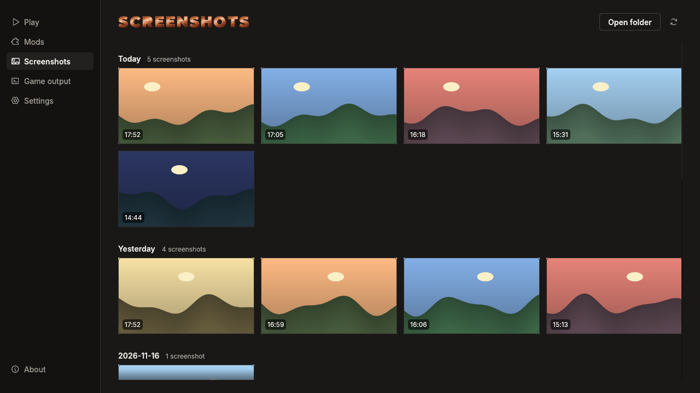

# The screenshot gallery

The Screenshots page (Ctrl+3) shows the pictures the game takes. Code: `crates/core/src/gallery.rs` and its folder (scanning,
sorting, grouping, thumbnails and their cache, the file actions; no UI), `crates/ui/src/gallery.rs` (state, the worker
threads, the large view's actions) and `crates/ui/src/pages/screenshots.rs` (the grid and the large view).

## Where the pictures are

The game writes `screenshots/castanea-<milliseconds since 1970>.png` in its working directory when you press its screenshot key
(F2 by default; castanea `src/frontend/render/screenshot.rs`). The launcher's game folder is the working directory, so the
folder is `<data>/game/screenshots` (Settings → Game folder). The file name is the only metadata: no world, no position.

- **Date and time**: the milliseconds in the name (13 digits, 2020 to 2100). A file with another name (one you added or renamed)
  uses its modification time. The day is the local calendar day (`localtime_r` on Linux, `SystemTimeToTzSpecificLocalTime`
  on Windows, so daylight saving is right for old shots too).
- **Order and groups**: newest first (ties by name, so the order never flickers); a header per day: `Today`, `Yesterday`, then
  `2026-11-16`, with the number of shots. The game's file names say nothing about the world, so there is no grouping by world. The
  launcher does know when it started and ended the game and which world or server it started ([quick-start.md](quick-start.md)),
  but a world opened from the game's own menu is only known by its saves' modification time, which is not a reliable label for a
  single picture. If the game wrote the world name into the file name or a text chunk of the PNG, the gallery could group by it.
- A folder that does not exist is an empty list; links and sub-folders are ignored.

## Thumbnails

- **Never on the UI thread.** Two worker threads (`gallery/pool.rs`) decode and scale; the UI only uploads the finished small
  picture as a texture. The UI says each frame which thumbnails it wants (the ones in view first, then a row on each side); what
  is no longer wanted is dropped from the queue, so a fast scroll leaves no backlog, and a picture is never made twice at once.
- **Lazy and cached.** A thumbnail (384 px on its longest side) is made when its row comes into view and kept as a small JPEG in
  `<cache>/thumbnails/<key>.jpg`; the key is a hash of the path, size, modification time and edge, so a changed or renamed file gets
  a new one. After each scan the cache drops thumbnails of files that are gone and stays under 96 MB (the oldest go first). The cache
  is part of Settings → Storage and reset → Cache.
- **Bounded memory.** At most 160 thumbnail textures (about 50 MB) are kept, least recently used out first; the large view holds one
  picture, scaled to at most 2560 px on its longest side. A decode refuses files over 128 MB, images wider or taller than 12,000 px
  and anything that needs more than 512 MB to decode.
- **Huge folders.** A scan reads only the folder's entries and their metadata, on a worker thread (4000 files take well under a
  second in the tests). The grid is virtual: only the rows that touch the window are drawn, whatever the number of files (a test
  puts 3003 files in the folder and checks that one screenful is decoded).
- **Unreadable files** (damaged, empty, not a picture, too big) show a placeholder with `Cannot read` and are not tried again until
  the next scan; the large view says why it cannot show them. The neighbours are not affected.

## When the list is read again

At the first frame, when the page is opened, when the window gets the focus back while the page is open (a screenshot taken in the
game appears when you come back), when the game ends, and with the Refresh button. The large view stays on its file across a scan.

## The large view

Click a thumbnail (or Tab to it and press Enter). The picture fits the page; a thumbnail stands in until the full picture is decoded.

| Action | How |
|---|---|
| Newer / older picture | Left / Right arrow, or the strips at the picture's edges (the order is newest first, so Left is newer) |
| First / last | Home / End |
| Back to the grid | Esc or *Back* (a question or a rename in progress takes the first Esc) |
| Open | the system's default program (`xdg-open`, Explorer) |
| Show in folder | Windows: Explorer with the file selected; Linux: the folder in the file manager |
| Copy | the picture at its real size to the clipboard (decoded on a worker; a toast says when it is done) |
| Rename | a text field for the name without its extension; the extension stays, an existing file is never replaced, separators and characters Windows refuses are refused |
| Delete (or the Delete key) | asks, then moves the file to the trash |

**Trash.** Linux: the FreeDesktop trash in `$XDG_DATA_HOME/Trash` (`files/` and `info/*.trashinfo`, restorable from the file manager);
Windows: the Recycle Bin (`SHFileOperationW` with `FOF_ALLOWUNDO`, no dialog); macOS: `~/.Trash`. When the trash cannot take the
file (another disk, no trash folder) the launcher says so and asks a second time whether to delete it for good. Enter never answers
these questions. The gallery only touches image files directly in the screenshots folder: any other path is refused.

## Tests

`crates/core/src/gallery/tests.rs`: the time in a file name, scanning (order, links, sub-folders, a missing folder, 4000 files),
day groups with a time zone offset, the civil date arithmetic, thumbnails (scaling, the cache hit without the source, new keys for
changed files, damaged, empty and oversized files, pruning by key and by size), the large view's downscale, rename, delete and the
trash folder layout. `crates/ui/src/tests/gallery.rs`: empty state in both languages, the grid and its groups, a big folder, a damaged
file, a refresh, focus rescans, keyboard stepping and Esc, the questions, delete, rename, the clipboard and every size. The pages are
also part of the all-pages tests (every size, both languages, screen reader names, no repaint when idle). Pictures for this page:
[screenshots/screenshots.png](screenshots/screenshots.png), [-de](screenshots/screenshots-de.png),
[-empty](screenshots/screenshots-empty.png), [the large view](screenshots/screenshot-view.png), made by `tools/screenshots.sh`
(the demo folder holds generated pictures).

## What the game could add

Nothing is needed. Two things would make the gallery better: the world (or server) name in the file name or in a PNG text chunk, which
would allow grouping by world, and the size of the window in a text chunk. The launcher does not change the game.
